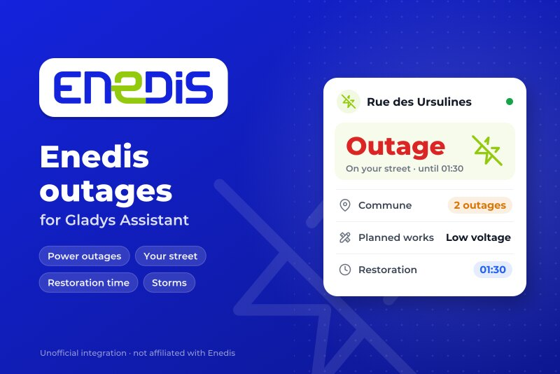
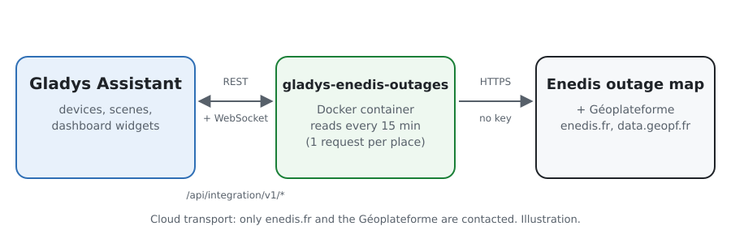
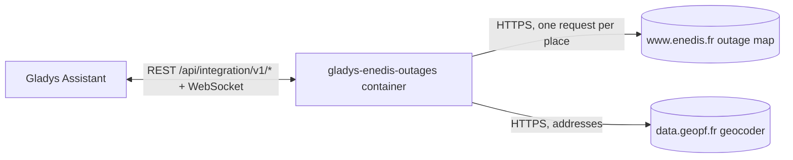
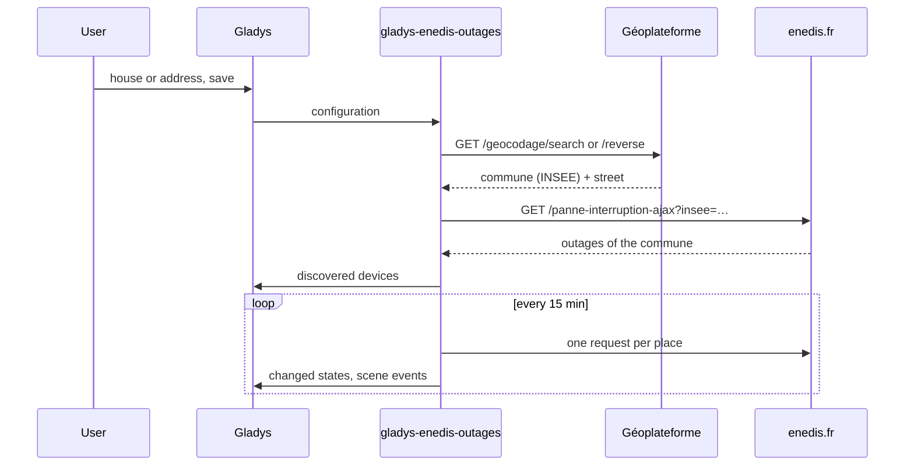
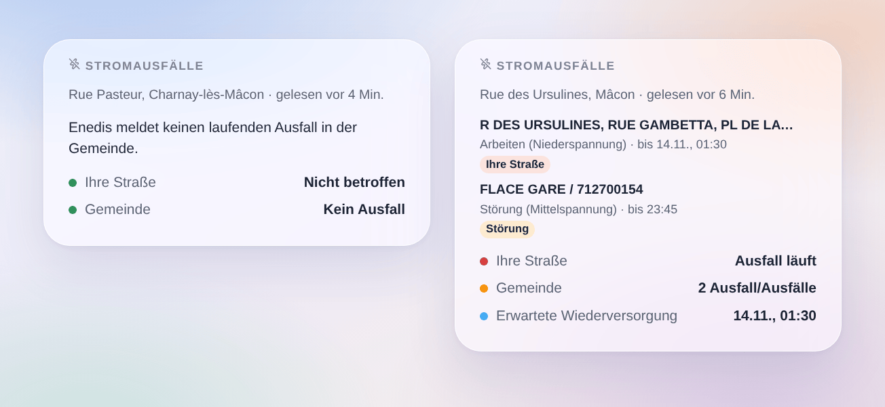

# Gladys Enedis-Stromausfälle

[English](README.md) · [Français](README.fr.md) · **Deutsch** · [Español](README.es.md)

[](LICENSE)
[](https://github.com/William-De71/gladys-enedis-outages/releases)
[](https://github.com/William-De71/gladys-enedis-outages/actions/workflows/release.yml)
[](https://gladysassistant.com)



Eine externe Integration für [Gladys Assistant](https://gladysassistant.com), die die Stromausfälle, die Enedis auf seiner Ausfallkarte veröffentlicht, für Ihre Gemeinde und Ihre Straße im französischen Festland in Gladys bringt. Laufende Ausfälle, ihre erwartete Wiederversorgung und außergewöhnliche Ereignisse von Enedis werden zu Geräten, Szenen-Auslösern und einem Widget. Ohne Konto, ohne Schlüssel.

## Funktionen

- Ein **Gerät pro Ort** (ein Haus von Gladys oder eine Adresse, bis zu drei): Ausfall in Ihrer Straße oder in der Gemeinde (0 bis 2), Anzahl der Ausfälle, die Lage als Satz.
- **4 Szenen-Auslöser**: Stromausfall (Filter: in meiner Straße oder anderswo, Art), Strom wieder da, Wiederversorgung verschoben, außergewöhnliches Ereignis.
- **1 Szenen-Aktion**: die Ausfälle eines Ortes lesen, für eine Nachricht oder Bedingung.
- **1 Dashboard-Widget**: Ihre Straße, die Ausfälle der Gemeinde, ihre Orte, Art und erwartete Wiederversorgung.
- Ohne Konto, ohne Schlüssel; standardmäßig eine Anfrage pro Ort alle 15 Minuten.
- Englisch, Französisch, Deutsch und Spanisch überall.

## Funktionsweise





Enedis hat keine offene API für seine Ausfälle. Seine öffentliche Seite [Panne et interruption](https://www.enedis.fr/resultat-panne-interruption) liest sie für eine Gemeinde aus einer JSON-Antwort der Website (`/panne-interruption-ajax?insee=…`): die Integration fragt sie genauso ab, mit eigenem User-Agent, einmal pro Ort und Abfrage. Jeder Ort wird zuerst vom Geocoder der [Géoplateforme](https://geoservices.ign.fr/documentation/services/services-geoplateforme/geocodage) (IGN) in eine Gemeinde (INSEE-Code) und eine Straße umgewandelt: die nächste Adresse zu einem Haus von Gladys oder die eingegebene Adresse. Ein Ausfall ist „in Ihrer Straße“, wenn Enedis diese Straße unter den betroffenen Orten nennt. Die erste Abfrage nach einem Start ist eine Referenz: Übergänge werden ab der nächsten gemeldet.



Nichts wird aus Gladys gesteuert: es gibt keinen `set value`-Schritt. Der Endpunkt von Enedis ist keine dokumentierte API und kann sich ändern: die Integration meldet eine unerwartete Antwort, statt zu raten.

### Transport

Nur **Cloud** (`"transports": ["cloud"]`): Gladys zeigt das Cloud-Abzeichen im Katalog. Die Integration spricht nur mit `www.enedis.fr` (die Gemeinde jedes Ortes) und `data.geopf.fr` (die Adresse oder die Position des Hauses).

## Geräte und Funktionen

| Gerät                         | Funktion                 | Gladys-Kategorie / -Typ                           |
| ----------------------------- | ------------------------ | ------------------------------------------------- |
| Enedis `<Straße>, <Gemeinde>` | Stromausfall             | Risiko (Ganzzahl), 0 keiner, 1 Gemeinde, 2 Straße |
|                               | Ausfälle in der Gemeinde | Zähler (Ganzzahl)                                 |
|                               | Lage                     | Text                                              |

Die externen IDs beruhen auf dem INSEE-Code der Gemeinde und den Wörtern der Straße (`71270-ursulines`), nie auf einem Anzeigenamen. In Paris, Lyon und Marseille ist der Ort das Arrondissement.

## Szenen-Auslöser, -Aktionen und Widget

| Art      | Schlüssel             | Verwendung                                                                |
| -------- | --------------------- | ------------------------------------------------------------------------- |
| Auslöser | `outage_started`      | Ein neuer Ausfall in der Gemeinde (Filter: Straße oder anderswo, Art)     |
| Auslöser | `outage_ended`        | Ein Ausfall ist beendet oder nicht mehr gelistet, mit seiner Dauer        |
| Auslöser | `restoration_changed` | Die erwartete Wiederversorgung wird verschoben oder vorgezogen            |
| Auslöser | `crisis_changed`      | Enedis beginnt oder beendet ein außergewöhnliches Ereignis (Sturm…)       |
| Aktion   | `get_outages`         | Ausfall in der Gemeinde, in meiner Straße, Anzahl, Wiederversorgung       |
| Widget   | `outages`             | Ihre Straße, Ausfälle der Gemeinde, Orte, Art, erwartete Wiederversorgung |

Szenen-Beispiele:

- Wenn ein Ausfall in meiner Straße beginnt → eine Nachricht mit `{{triggerEvent.data.summary}}` senden.
- Wenn der Strom wieder da ist → die Wärmepumpe oder Szenen neu starten, die ein Ausfall gestoppt haben könnte.
- Wenn die Wiederversorgung verschoben wird → `{{triggerEvent.data.restoration_at}}` senden.
- Jeden Abend → die Ausfälle lesen und die Nachtprogramme bei angekündigten Arbeiten auslassen.



## Voraussetzungen

- Gladys Assistant **5.3.0** oder neuer (Haus-Auswahl, Katalog-Schlüsselwörter, Widgets und Szenen externer Integrationen). Ältere Instanzen können sie nicht installieren.
- Ein Ort im französischen Festland, den Enedis versorgt (etwa 95 % der Gemeinden; nicht die eines lokalen Versorgers wie Straßburg, Grenoble oder Metz, weder Korsika noch Übersee).

## Installation

- **Aus dem Store**: Integrationen → „Enedis“ suchen → Installieren.
- **Über die Repository-URL**: Integrationen → Integration installieren → `https://github.com/William-De71/gladys-enedis-outages`.
- **Entwicklermodus**: Integrationen → Integration installieren → Entwicklermodus, mit dem Image `ghcr.io/william-de71/gladys-enedis-outages:<version>`.

## Konfiguration

| Feld                | Pflicht | Beschreibung                                                            |
| ------------------- | ------- | ----------------------------------------------------------------------- |
| Haus (Orte 1 bis 3) | Nein    | Ein Haus von Gladys: die nächste Adresse ergibt Gemeinde und Straße     |
| Oder eine Adresse   | Nein    | Hat Vorrang vor dem Haus; ohne Straße wird nur die Gemeinde überwacht   |
| Enedis gelesen alle | Nein    | 5, 10, 15 (Standard), 30 oder 60 Minuten                                |
| Sprache der Texte   | Nein    | Gerätenamen, Lagen, Szenen-Zusammenfassungen; standardmäßig automatisch |

**Orte prüfen** zeigt die gefundene Gemeinde und Straße jedes Ortes und liest Enedis sofort.

## Verwendung

1. Für jeden Ort ein Haus wählen oder eine Adresse eingeben, dann speichern.
2. Geräte → Coupures Enedis → Entdecken: die Orte hinzufügen.
3. Szenen: einen Enedis-Auslöser wählen, nach Gerät und „meiner Straße“ filtern, die Variablen in einer Nachricht nutzen.
4. Dashboard: das Widget „Stromausfälle“ hinzufügen.

Die Benutzerdokumentation steht in [docs/de.md](docs/de.md) ([en](docs/en.md), [fr](docs/fr.md), [es](docs/es.md)).

## Entwicklung

```bash
npm install
npm test                       # node --test, ohne Netzwerkzugriff
npm run lint                   # ESLint
npm run format:check           # Prettier
npx github:GladysAssistant/integration-store . --skip-image-check
scripts/build-cover.sh         # cover.jpg aus docs/assets/cover.svg
docs/illustrations/render.sh   # docs/assets/widgets.<lang>.png
```

Lokal liest das SDK `GLADYS_HOST_API_URL`, `GLADYS_INTEGRATION_TOKEN` und `GLADYS_INTEGRATION_SELECTOR` (von Gladys im Entwicklermodus geliefert). `DEBUG=gladys-integration-sdk` zeigt die Logs des SDK.

Die Tests decken die Clients von Enedis und des Geocoders, das Lesen der Antworten (Pariser Zeit, Arrondissements, Straßenabgleich), die Übergänge, die Geräte, das Widget (`validateWidgetContent`), die Szenen-Ereignisse und -Ausgaben, das Manifest, die vier Sprachen, das Release-Skript und die ganze Integration gegen das falsche Gladys des SDK und ein falsches enedis.fr ab. `test/structure.test.js` friert jeden Schlüssel ein, den Benutzer speichern.

## Release-Prozess


Jeder Merge auf `main` startet die CI und berechnet dann die Version aus den [Conventional Commits](https://www.conventionalcommits.org/) seit dem letzten Tag: `feat` → Minor, `fix` / `perf` → Patch, `!` oder `BREAKING CHANGE` → Major (Minor unter 1.0.0); `docs`, `chore`, `ci`, `test`, `style`, `refactor`, `build` allein veröffentlichen nichts. Der Changelog-Abschnitt wird erzeugt, der Tag gepusht, das Multi-Architektur-Image gebaut, dann erhält `main` den Release-Commit, das GitHub-Release wird erstellt und ein letzter Job prüft das öffentliche Image, den Store-Validator und das Topic.

- Der Titel des Pull Requests wird zum Squash-Commit und dann zur Changelog-Zeile: Schreiben Sie ihn auf Englisch, für den Benutzer (`pr-title.yml` prüft ihn). Bearbeiten Sie `CHANGELOG.md` nie von Hand.
- 1.0.0 ist eine Entscheidung: Actions → Release → Run workflow mit `release-as: 1.0.0`. `dry-run` zeigt Version und Notizen, ohne zu veröffentlichen.
- **Geschützter Branch**: Das Release pusht seinen Commit mit `GITHUB_TOKEN` auf `main`. Mit einem Ruleset auf `main`, das strenger ist als „kein Löschen, kein Force-Push“, fügen Sie GitHub Actions zur Ausnahmeliste hinzu (oder pushen Sie über eine GitHub App), sonst schlägt der Veröffentlichungs-Job mit Anweisungen fehl.
- Machen Sie nach dem ersten Release das `ghcr.io`-Paket öffentlich (Package settings → Change visibility), sonst kann Gladys es nicht laden.

## Fehlerbehebung

Siehe [docs/de.md](docs/de.md#fehlerbehebung). Melden Sie Probleme mit den Versionen von Gladys und der Integration und den Logs (`DEBUG=gladys-integration-sdk`).

## Mitwirken

Issues und Pull Requests sind willkommen. Führen Sie vor einem Pull Request `npm run format:check && npm run lint && npm test` aus und lassen Sie alle externen IDs und gespeicherten Schlüssel unverändert (siehe [CLAUDE.md](CLAUDE.md)).

## Sicherheit

Siehe [SECURITY.md](SECURITY.md): Melden Sie Schwachstellen vertraulich. Es gibt weder Konto noch Schlüssel: die Integration sendet nur die Gemeinde jedes Ortes an enedis.fr und die eingegebene Adresse (oder die Position des Hauses) an die Géoplateforme.

## Kommende Screenshots

Die Bilder oben sind Illustrationen, keine Screenshots. Echte Screenshots kommen nach `docs/assets/screenshots/` (PNG, 1280 × 800): `configuration.png`, `discovery.png`, `device.png`, `scene.png`.

## Lizenz

[Apache-Lizenz 2.0](LICENSE) — siehe auch [NOTICE](NOTICE). Enedis ist eine Marke ihres Inhabers; diese Community-Integration ist weder mit Enedis verbunden noch von Enedis unterstützt. Sie liest die öffentliche Ausfallkarte von [enedis.fr](https://www.enedis.fr/resultat-panne-interruption) und den Geocoder der [Géoplateforme](https://geoservices.ign.fr/documentation/services/services-geoplateforme/geocodage) (IGN, Base Adresse Nationale, offene Lizenz). Dank an die Dokumentation und das SDK von Gladys.
