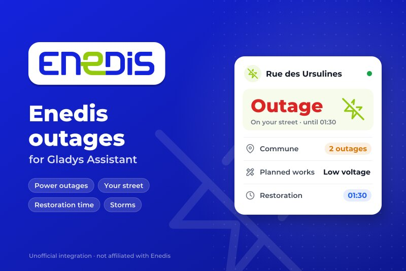
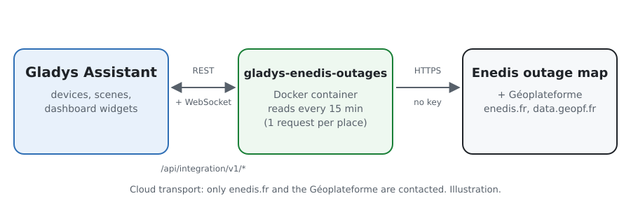
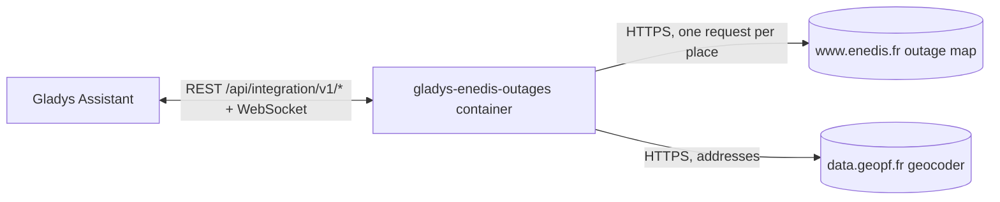
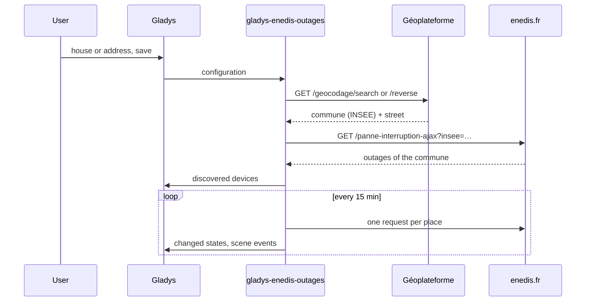
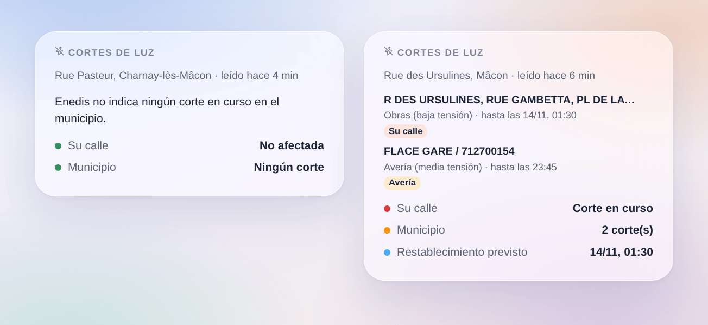

# Gladys Cortes de Enedis

[English](README.md) · [Français](README.fr.md) · [Deutsch](README.de.md) · **Español**

[](LICENSE)
[](https://github.com/William-De71/gladys-enedis-outages/releases)
[](https://github.com/William-De71/gladys-enedis-outages/actions/workflows/release.yml)
[](https://gladysassistant.com)



Una integración externa para [Gladys Assistant](https://gladysassistant.com) que trae a Gladys los cortes de luz que Enedis publica en su mapa de cortes, para su municipio y su calle, en la Francia continental. Los cortes en curso, su restablecimiento previsto y los eventos excepcionales de Enedis se convierten en dispositivos, disparadores de escena y un widget. Sin cuenta ni clave.

## Funcionalidades

- Un **dispositivo por lugar** (una casa de Gladys o una dirección, hasta tres): corte en su calle o en el municipio (0 a 2), número de cortes, la situación en una frase.
- **4 disparadores de escena**: corte de luz (filtros: en mi calle o en otro sitio, tipo), luz restablecida, hora de restablecimiento cambiada, evento excepcional.
- **1 acción de escena**: leer los cortes de un lugar, para un mensaje o una condición.
- **1 widget de panel**: su calle, los cortes del municipio, sus lugares, tipo y restablecimiento previsto.
- Sin cuenta ni clave; una petición por lugar cada 15 minutos por defecto.
- Inglés, francés, alemán y español en todas partes.

## Funcionamiento





Enedis no tiene una API abierta para sus cortes. Su página pública [Panne et interruption](https://www.enedis.fr/resultat-panne-interruption) los lee, para un municipio, de una respuesta JSON del sitio (`/panne-interruption-ajax?insee=…`): la integración la pide de la misma forma, identificándose en el User-Agent, una vez por lugar y por lectura. Cada lugar se convierte primero en un municipio (código INSEE) y una calle gracias al geocodificador de la [Géoplateforme](https://geoservices.ign.fr/documentation/services/services-geoplateforme/geocodage) (IGN): la dirección más cercana a una casa de Gladys, o la dirección escrita. Un corte está «en su calle» cuando Enedis cita esa calle entre los lugares cortados. La primera lectura tras un arranque es una referencia: las transiciones se indican a partir de la siguiente.



Nada se controla desde Gladys: no hay paso `set value`. El punto de acceso de Enedis no es una API documentada y puede cambiar: la integración indica una respuesta inesperada en lugar de adivinar.

### Transporte

Solo **nube** (`"transports": ["cloud"]`): Gladys muestra la insignia Cloud en el catálogo. La integración solo habla con `www.enedis.fr` (el municipio de cada lugar) y `data.geopf.fr` (la dirección o la posición de la casa).

## Dispositivos y funciones

| Dispositivo                   | Función                | Categoría / tipo de Gladys                       |
| ----------------------------- | ---------------------- | ------------------------------------------------ |
| Enedis `<calle>, <municipio>` | Corte de luz           | Riesgo (entero), 0 ninguno, 1 municipio, 2 calle |
|                               | Cortes en el municipio | Contador (entero)                                |
|                               | Situación              | Texto                                            |

Los identificadores externos se basan en el código INSEE del municipio y las palabras de la calle (`71270-ursulines`), nunca en un nombre mostrado. En París, Lyon y Marsella, el lugar es el distrito.

## Disparadores, acciones de escena y widget

| Tipo       | Clave                 | Uso                                                                |
| ---------- | --------------------- | ------------------------------------------------------------------ |
| Disparador | `outage_started`      | Un nuevo corte en el municipio (filtros: calle u otro sitio, tipo) |
| Disparador | `outage_ended`        | Un corte está cerrado o ya no se lista, con su duración            |
| Disparador | `restoration_changed` | El restablecimiento previsto se aplaza o se adelanta               |
| Disparador | `crisis_changed`      | Enedis abre o cierra un evento excepcional (tormenta…)             |
| Acción     | `get_outages`         | Corte en el municipio, en mi calle, número, restablecimiento       |
| Widget     | `outages`             | Su calle, cortes del municipio, lugares, tipo, restablecimiento    |

Ejemplos de escenas:

- Cuando empieza un corte en mi calle → enviar un mensaje con `{{triggerEvent.data.summary}}`.
- Cuando vuelve la luz → reiniciar la bomba de calor, o las escenas que un corte haya podido parar.
- Cuando se aplaza el restablecimiento → enviar `{{triggerEvent.data.restoration_at}}`.
- Cada noche → leer los cortes y saltar los programas nocturnos si hay obras anunciadas.



## Requisitos

- Gladys Assistant **5.3.0** o posterior (selector de casa, palabras clave del catálogo, widgets y escenas de integraciones externas). Las instancias más antiguas no pueden instalarla.
- Un lugar de la Francia continental abastecido por Enedis (cerca del 95 % de los municipios; no los de una empresa local como Estrasburgo, Grenoble o Metz, ni Córcega ni ultramar).

## Instalación

- **Desde la tienda**: Integraciones → buscar «Enedis» → Instalar.
- **Desde la URL del repositorio**: Integraciones → Instalar una integración → `https://github.com/William-De71/gladys-enedis-outages`.
- **Modo desarrollador**: Integraciones → Instalar una integración → Modo desarrollador, con la imagen `ghcr.io/william-de71/gladys-enedis-outages:<version>`.

## Configuración

| Campo                | Obligatorio | Descripción                                                             |
| -------------------- | ----------- | ----------------------------------------------------------------------- |
| Casa (lugares 1 a 3) | No          | Una casa de Gladys: la dirección más cercana da municipio y calle       |
| O una dirección      | No          | Prevalece sobre la casa; sin calle, solo se vigila el municipio         |
| Enedis leído cada    | No          | 5, 10, 15 (por defecto), 30 o 60 minutos                                |
| Idioma de los textos | No          | Nombres de dispositivos, situaciones, resúmenes; automático por defecto |

**Comprobar los lugares** muestra el municipio y la calle encontrados para cada lugar y lee Enedis al momento.

## Uso

1. Elija una casa o escriba una dirección para cada lugar, y guarde.
2. Dispositivos → Coupures Enedis → Descubrir: añada los lugares.
3. Escenas: elija un disparador Enedis, filtre por dispositivo y por «mi calle», use las variables en un mensaje.
4. Panel: añada el widget «Cortes de luz».

La documentación de usuario está en [docs/es.md](docs/es.md) ([en](docs/en.md), [fr](docs/fr.md), [de](docs/de.md)).

## Desarrollo

```bash
npm install
npm test                       # node --test, sin tocar nunca la red
npm run lint                   # ESLint
npm run format:check           # Prettier
npx github:GladysAssistant/integration-store . --skip-image-check
scripts/build-cover.sh         # cover.jpg a partir de docs/assets/cover.svg
docs/illustrations/render.sh   # docs/assets/widgets.<lang>.png
```

En local, el SDK lee `GLADYS_HOST_API_URL`, `GLADYS_INTEGRATION_TOKEN` y `GLADYS_INTEGRATION_SELECTOR` (que Gladys da en modo desarrollador). `DEBUG=gladys-integration-sdk` muestra los logs del SDK.

Las pruebas cubren los clientes de Enedis y del geocodificador, la lectura de las respuestas (hora de París, distritos, comparación de calles), las transiciones, los dispositivos, el widget (`validateWidgetContent`), los eventos y salidas de escena, el manifiesto, los cuatro idiomas, el script de release, y toda la integración frente al Gladys falso del SDK y un enedis.fr falso. `test/structure.test.js` congela todas las claves que guardan los usuarios.

## Proceso de release


Cada fusión en `main` lanza la CI y calcula la versión a partir de los [Conventional Commits](https://www.conventionalcommits.org/) desde la última etiqueta: `feat` → menor, `fix` / `perf` → parche, `!` o `BREAKING CHANGE` → mayor (menor por debajo de 1.0.0); `docs`, `chore`, `ci`, `test`, `style`, `refactor`, `build` solos no publican nada. Se genera la sección del changelog, se empuja la etiqueta, se construye la imagen multiarquitectura, luego `main` recibe el commit de release, se crea la GitHub Release y un último job comprueba la imagen pública, el validador de la tienda y el topic.

- El título del pull request se convierte en el commit squash y luego en la línea del changelog: escríbalo en inglés, para el usuario (`pr-title.yml` lo comprueba). No edite nunca `CHANGELOG.md` a mano.
- La 1.0.0 es una decisión: Actions → Release → Run workflow con `release-as: 1.0.0`. `dry-run` muestra la versión y las notas sin publicar.
- **Rama protegida**: la release empuja su commit a `main` con `GITHUB_TOKEN`. Con un ruleset en `main` más estricto que «ni borrado ni force push», añada GitHub Actions a su lista de excepciones (o empuje mediante una GitHub App); si no, el job de publicación falla con instrucciones.
- Tras la primera release, haga público el paquete `ghcr.io` (Package settings → Change visibility), o Gladys no podrá descargarlo.

## Solución de problemas

Consulte [docs/es.md](docs/es.md#solución-de-problemas). Informe de los problemas con las versiones de Gladys y de la integración y los registros (`DEBUG=gladys-integration-sdk`).

## Contribuir

Issues y pull requests son bienvenidos. Ejecute `npm run format:check && npm run lint && npm test` antes de abrir un pull request y mantenga sin cambios todos los identificadores externos y claves guardadas (vea [CLAUDE.md](CLAUDE.md)).

## Seguridad

Vea [SECURITY.md](SECURITY.md): informe de las vulnerabilidades en privado. No hay cuenta ni clave: la integración solo envía el municipio de cada lugar a enedis.fr, y la dirección escrita (o la posición de la casa) a la Géoplateforme.

## Capturas por venir

Las imágenes de arriba son ilustraciones, no capturas de pantalla. Las capturas reales irán en `docs/assets/screenshots/` (PNG, 1280 × 800): `configuration.png`, `discovery.png`, `device.png`, `scene.png`.

## Licencia

[Licencia Apache 2.0](LICENSE) — vea también [NOTICE](NOTICE). Enedis es una marca de su propietario; esta integración comunitaria no está afiliada a Enedis ni respaldada por Enedis. Lee el mapa público de cortes de [enedis.fr](https://www.enedis.fr/resultat-panne-interruption) y el geocodificador de la [Géoplateforme](https://geoservices.ign.fr/documentation/services/services-geoplateforme/geocodage) (IGN, Base Adresse Nationale, licencia abierta). Gracias a la documentación y al SDK de Gladys.
