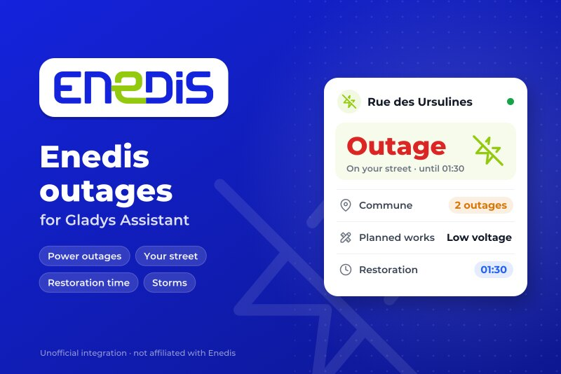
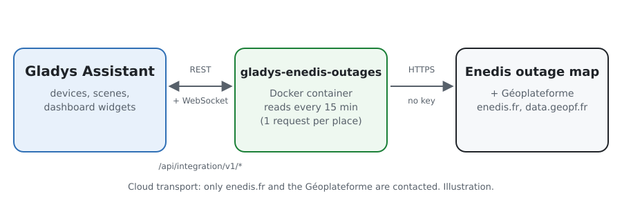
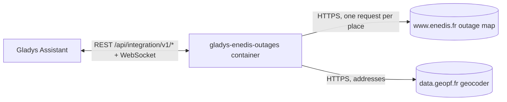
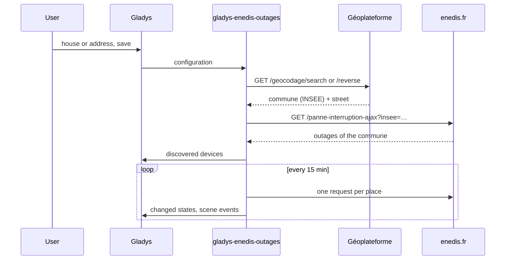
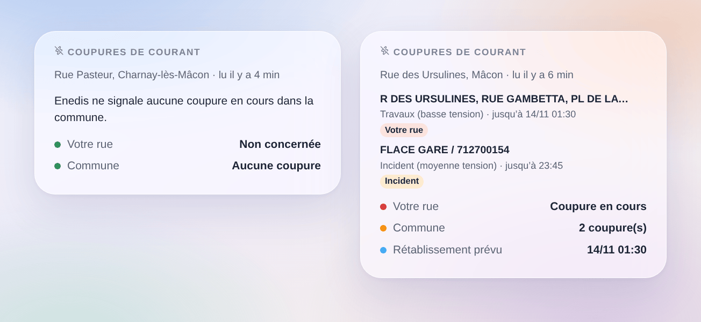

# Gladys Coupures Enedis

[English](README.md) · **Français** · [Deutsch](README.de.md) · [Español](README.es.md)

[](LICENSE)
[](https://github.com/William-De71/gladys-enedis-outages/releases)
[](https://github.com/William-De71/gladys-enedis-outages/actions/workflows/release.yml)
[](https://gladysassistant.com)



Une intégration externe pour [Gladys Assistant](https://gladysassistant.com) qui amène dans Gladys les coupures de courant qu’Enedis publie sur sa carte des coupures, pour votre commune et votre rue, en France métropolitaine. Les coupures en cours, leur rétablissement prévu et les événements exceptionnels d’Enedis deviennent des appareils, des déclencheurs de scène et un widget. Sans compte ni clé.

## Fonctionnalités

- Un **appareil par lieu** (une maison de Gladys ou une adresse, trois au plus) : coupure dans votre rue ou dans la commune (0 à 2), nombre de coupures, la situation en une phrase.
- **4 déclencheurs de scène** : coupure de courant (filtres : dans ma rue ou ailleurs, type), courant rétabli, heure de rétablissement modifiée, événement exceptionnel.
- **1 action de scène** : lire les coupures d’un lieu, pour un message ou une condition.
- **1 widget** : votre rue, les coupures de la commune, leurs lieux, leur type et le rétablissement prévu.
- Sans compte ni clé ; une requête par lieu toutes les 15 minutes par défaut.
- Anglais, français, allemand et espagnol partout.

## Fonctionnement





Enedis n’a pas d’API ouverte pour ses coupures. Sa page publique [Panne et interruption](https://www.enedis.fr/resultat-panne-interruption) les lit, pour une commune, dans une réponse JSON du site (`/panne-interruption-ajax?insee=…`) : l’intégration la demande de la même façon, en se nommant dans le User-Agent, une fois par lieu et par lecture. Chaque lieu devient d’abord une commune (code INSEE) et une rue grâce au géocodeur de la [Géoplateforme](https://geoservices.ign.fr/documentation/services/services-geoplateforme/geocodage) (IGN) : l’adresse la plus proche d’une maison de Gladys, ou l’adresse saisie. Une coupure est « dans votre rue » quand Enedis cite cette rue parmi les lieux coupés. La première lecture après un démarrage sert de référence : les transitions sont signalées à partir de la suivante.



Rien n’est commandé depuis Gladys : il n’y a pas d’étape `set value`. Le point d’accès d’Enedis n’est pas une API documentée et peut changer : l’intégration signale une réponse inattendue au lieu de deviner.

### Transport

**Cloud** uniquement (`"transports": ["cloud"]`) : Gladys affiche le badge Cloud dans le catalogue. L’intégration ne parle qu’à `www.enedis.fr` (la commune de chaque lieu) et à `data.geopf.fr` (l’adresse ou la position de la maison).

## Appareils et fonctionnalités

| Appareil                  | Fonctionnalité           | Catégorie / type Gladys                     |
| ------------------------- | ------------------------ | ------------------------------------------- |
| Enedis `<rue>, <commune>` | Coupure de courant       | Risque (entier), 0 aucune, 1 commune, 2 rue |
|                           | Coupures dans la commune | Compteur (entier)                           |
|                           | Situation                | Texte                                       |

Les identifiants externes reposent sur le code INSEE de la commune et les mots de la rue (`71270-ursulines`), jamais sur un nom affiché. À Paris, Lyon et Marseille, le lieu est l’arrondissement.

## Déclencheurs, actions de scène et widget

| Type        | Clé                   | Usage                                                                    |
| ----------- | --------------------- | ------------------------------------------------------------------------ |
| Déclencheur | `outage_started`      | Une nouvelle coupure dans la commune (filtres : rue ou ailleurs, type)   |
| Déclencheur | `outage_ended`        | Une coupure est close ou n’est plus listée, avec sa durée                |
| Déclencheur | `restoration_changed` | Le rétablissement prévu est repoussé ou avancé                           |
| Déclencheur | `crisis_changed`      | Enedis ouvre ou clôt un événement exceptionnel (tempête…)                |
| Action      | `get_outages`         | Coupure dans la commune, dans ma rue, nombre, rétablissement, en sorties |
| Widget      | `outages`             | Votre rue, coupures de la commune, lieux, type, rétablissement prévu     |

Exemples de scènes :

- Quand une coupure commence dans ma rue → envoyer un message avec `{{triggerEvent.data.summary}}`.
- Quand le courant est rétabli → relancer la pompe à chaleur, ou les scènes qu’une coupure a pu arrêter.
- Quand le rétablissement est repoussé → envoyer `{{triggerEvent.data.restoration_at}}`.
- Chaque soir → lire les coupures et sauter les programmes de nuit quand des travaux sont annoncés.



## Prérequis

- Gladys Assistant **5.3.0** ou plus récent (sélecteur de maison, mots-clés du catalogue, widgets et scènes des intégrations externes). Les instances plus anciennes ne peuvent pas l’installer.
- Un lieu de France métropolitaine desservi par Enedis (environ 95 % des communes ; pas celles d’une régie locale comme Strasbourg, Grenoble ou Metz, ni la Corse et l’outre-mer).

## Installation

- **Depuis le store** : Intégrations → chercher « Enedis » → Installer.
- **Depuis l’URL du dépôt** : Intégrations → Installer une intégration → `https://github.com/William-De71/gladys-enedis-outages`.
- **Mode développeur** : Intégrations → Installer une intégration → Mode développeur, avec l’image `ghcr.io/william-de71/gladys-enedis-outages:<version>`.

## Configuration

| Champ                | Obligatoire | Description                                                               |
| -------------------- | ----------- | ------------------------------------------------------------------------- |
| Maison (lieux 1 à 3) | Non         | Une maison de Gladys : l’adresse la plus proche donne commune et rue      |
| Ou une adresse       | Non         | Prime sur la maison ; sans rue, seule la commune est surveillée           |
| Enedis lu toutes les | Non         | 5, 10, 15 (par défaut), 30 ou 60 minutes                                  |
| Langue des textes    | Non         | Noms des appareils, situations, résumés de scène ; automatique par défaut |

**Vérifier les lieux** affiche la commune et la rue trouvées pour chaque lieu et lit Enedis tout de suite.

## Utilisation

1. Choisissez une maison ou saisissez une adresse pour chaque lieu, puis enregistrez.
2. Appareils → Coupures Enedis → Découverte : ajoutez les lieux.
3. Scènes : choisissez un déclencheur Enedis, filtrez sur un appareil et sur « ma rue », utilisez les variables dans un message.
4. Tableau de bord : ajoutez le widget « Coupures de courant ».

La documentation utilisateur est dans [docs/fr.md](docs/fr.md) ([en](docs/en.md), [de](docs/de.md), [es](docs/es.md)).

## Développement

```bash
npm install
npm test                       # node --test, sans jamais toucher le réseau
npm run lint                   # ESLint
npm run format:check           # Prettier
npx github:GladysAssistant/integration-store . --skip-image-check
scripts/build-cover.sh         # cover.jpg depuis docs/assets/cover.svg
docs/illustrations/render.sh   # docs/assets/widgets.<lang>.png
```

En local, le SDK lit `GLADYS_HOST_API_URL`, `GLADYS_INTEGRATION_TOKEN` et `GLADYS_INTEGRATION_SELECTOR` (fournis par Gladys en mode développeur). `DEBUG=gladys-integration-sdk` affiche les logs du SDK.

Les tests couvrent les clients Enedis et du géocodeur, la lecture des réponses (heures de Paris, arrondissements, comparaison des rues), les transitions, les appareils, le widget (`validateWidgetContent`), les événements et sorties de scène, le manifeste, les quatre langues, le script de release, et toute l’intégration face au faux Gladys du SDK et à un faux enedis.fr. `test/structure.test.js` fige toutes les clés que les utilisateurs enregistrent.

## Processus de release


Chaque fusion sur `main` lance la CI, puis calcule la version d’après les [Conventional Commits](https://www.conventionalcommits.org/) depuis le dernier tag : `feat` → mineure, `fix` / `perf` → correctif, `!` ou `BREAKING CHANGE` → majeure (mineure sous 1.0.0) ; `docs`, `chore`, `ci`, `test`, `style`, `refactor`, `build` seuls ne publient rien. La section du changelog est générée, le tag poussé, l’image multi-architecture construite, puis `main` reçoit le commit de release, la GitHub Release est créée et un dernier job vérifie l’image publique, le validateur du store et le topic.

- Le titre de la pull request devient le commit squash, puis la ligne du changelog : écrivez-le en anglais, pour l’utilisateur (`pr-title.yml` le vérifie). Ne modifiez jamais `CHANGELOG.md` à la main.
- La 1.0.0 est une décision : Actions → Release → Run workflow avec `release-as: 1.0.0`. `dry-run` affiche la version et les notes sans rien publier.
- **Branche protégée** : la release pousse son commit sur `main` avec `GITHUB_TOKEN`. Avec un ruleset sur `main` plus strict que « ni suppression ni force-push », ajoutez GitHub Actions à sa liste de contournement (ou poussez par une GitHub App), sinon le job de publication échoue avec des instructions.
- Après la première release, rendez public le package `ghcr.io` (Package settings → Change visibility), sinon Gladys ne peut pas le télécharger.

## Dépannage

Voir [docs/fr.md](docs/fr.md#dépannage). Signalez les problèmes avec les versions de Gladys et de l’intégration et les logs (`DEBUG=gladys-integration-sdk`).

## Contribuer

Issues et pull requests bienvenues. Lancez `npm run format:check && npm run lint && npm test` avant d’ouvrir une pull request, et gardez inchangés tous les identifiants externes et clés enregistrées (voir [CLAUDE.md](CLAUDE.md)).

## Sécurité

Voir [SECURITY.md](SECURITY.md) : signalez les failles en privé. Il n’y a ni compte ni clé : l’intégration envoie seulement la commune de chaque lieu à enedis.fr, et l’adresse saisie (ou la position de la maison) à la Géoplateforme.

## Captures à venir

Les images ci-dessus sont des illustrations, pas des captures d’écran. Les vraies captures iront dans `docs/assets/screenshots/` (PNG, 1280 × 800) : `configuration.png`, `discovery.png`, `device.png`, `scene.png`.

## Licence

[Licence Apache 2.0](LICENSE) — voir aussi [NOTICE](NOTICE). Enedis est une marque de son propriétaire ; cette intégration communautaire n’est ni affiliée à Enedis, ni approuvée ou soutenue par Enedis. Elle lit la carte publique des coupures d’[enedis.fr](https://www.enedis.fr/resultat-panne-interruption) et le géocodeur de la [Géoplateforme](https://geoservices.ign.fr/documentation/services/services-geoplateforme/geocodage) (IGN, Base Adresse Nationale, licence ouverte). Merci à la documentation et au SDK de Gladys.
