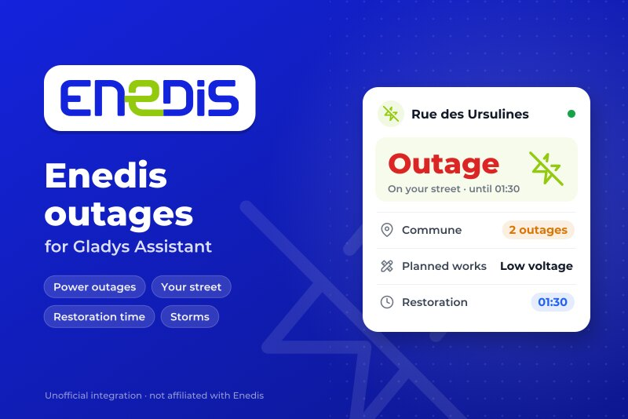
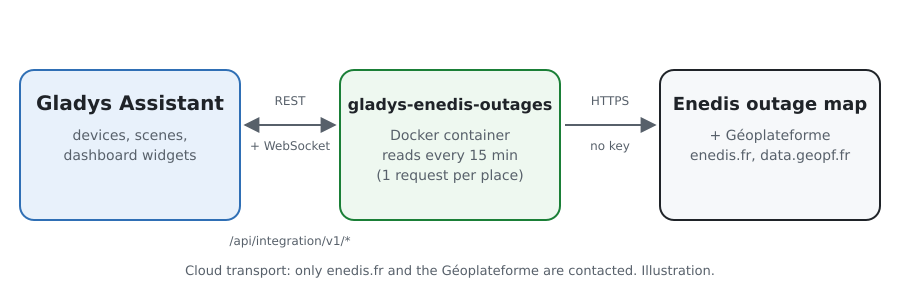
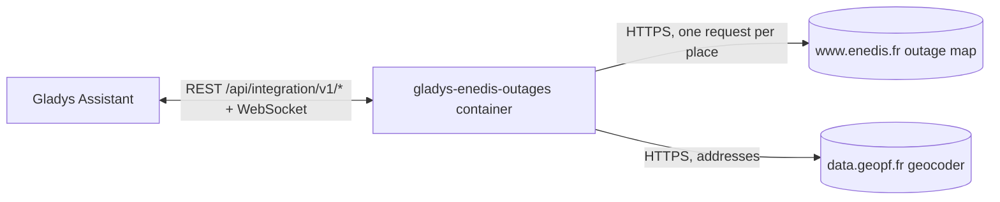
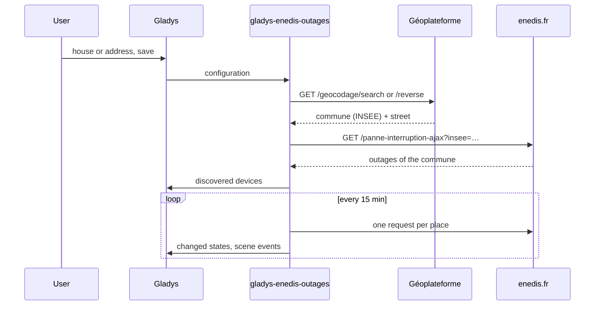
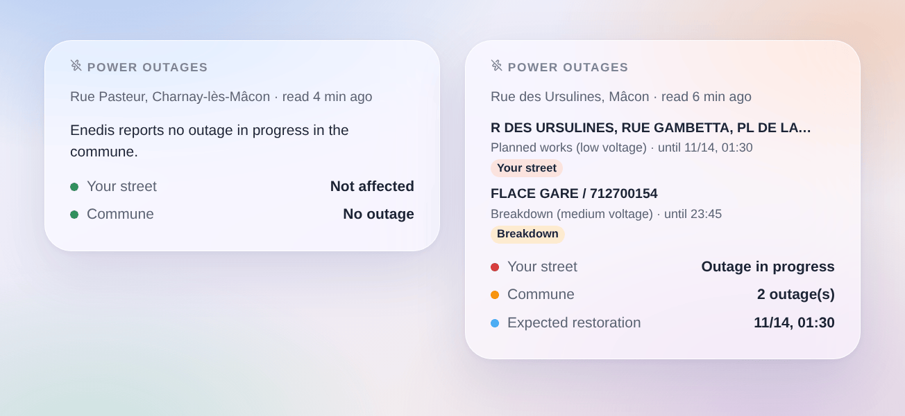

# Gladys Enedis outages

**English** · [Français](README.fr.md) · [Deutsch](README.de.md) · [Español](README.es.md)

[](LICENSE)
[](https://github.com/William-De71/gladys-enedis-outages/releases)
[](https://github.com/William-De71/gladys-enedis-outages/actions/workflows/release.yml)
[](https://gladysassistant.com)



An external integration for [Gladys Assistant](https://gladysassistant.com) that brings the power outages Enedis publishes on its outage map into Gladys, for your commune and your street, in mainland France. Outages in progress, their expected restoration and Enedis' exceptional events become devices, scene triggers and a dashboard widget. No account, no key.

## Features

- A **device per place** (a house of Gladys or an address, up to three): outage on your street or in the commune (0 to 2), number of outages, the situation as a sentence.
- **4 scene triggers**: power outage (filters: on my street or elsewhere, kind), power back, restoration time moved, exceptional event.
- **1 scene action**: read the outages of a place, for a message or a condition.
- **1 dashboard widget**: your street, the outages of the commune, their places, kind and expected restoration.
- No account, no key; one request per place every 15 minutes by default.
- English, French, German and Spanish everywhere.

## How it works





Enedis has no open API for its outages. Its public page [Panne et interruption](https://www.enedis.fr/resultat-panne-interruption) reads them, for a commune, from a JSON answer of the site (`/panne-interruption-ajax?insee=…`): the integration asks it the same way, naming itself in the User-Agent, once per place and per reading. Each place is first turned into a commune (INSEE code) and a street by the geocoder of the [Géoplateforme](https://geoservices.ign.fr/documentation/services/services-geoplateforme/geocodage) (IGN): the nearest address to a house of Gladys, or the address typed. An outage is "on your street" when Enedis names that street among the places cut. The first reading after a start is a reference: transitions are reported from the next one on.



Nothing is controlled from Gladys: there is no `set value` step. Enedis' endpoint is not a documented API and may change: the integration reports an unexpected answer instead of guessing.

### Transport

**Cloud** only (`"transports": ["cloud"]`): Gladys shows the Cloud badge in the catalog. The integration talks to `www.enedis.fr` (the commune of each place) and `data.geopf.fr` (the address or the position of the house), and nothing else.

## Devices and features

| Device                       | Feature                | Gladys category / type                      |
| ---------------------------- | ---------------------- | ------------------------------------------- |
| Enedis `<street>, <commune>` | Power outage           | Risk (integer), 0 none, 1 commune, 2 street |
|                              | Outages in the commune | Counter (integer)                           |
|                              | Situation              | Text                                        |

External ids rely on the INSEE code of the commune and the words of the street (`71270-ursulines`), never on a display name. In Paris, Lyon and Marseille, the place is the arrondissement.

## Scene triggers, actions and widget

| Kind    | Key                   | Use                                                                     |
| ------- | --------------------- | ----------------------------------------------------------------------- |
| Trigger | `outage_started`      | A new outage in the commune (filters: street or elsewhere, kind)        |
| Trigger | `outage_ended`        | An outage is closed or no longer listed, with its duration              |
| Trigger | `restoration_changed` | The expected restoration is postponed or brought forward                |
| Trigger | `crisis_changed`      | Enedis starts or ends an exceptional event (storm…)                     |
| Action  | `get_outages`         | Outage in the commune, on my street, count, restoration, as outputs     |
| Widget  | `outages`             | Your street, outages of the commune, places, kind, expected restoration |

Scene examples:

- When an outage starts on my street → send a message with `{{triggerEvent.data.summary}}`.
- When the power is back → restart the heat pump, or the scenes a cut may have stopped.
- When the restoration is postponed → send `{{triggerEvent.data.restoration_at}}`.
- Every evening → read the outages and skip the night programmes when works are announced.



## Requirements

- Gladys Assistant **5.3.0** or later (house selector, catalog keywords, widgets and scenes of external integrations). Older instances cannot install it.
- A place in mainland France served by Enedis (about 95 % of communes; not the communes of a local company such as Strasbourg, Grenoble or Metz, nor Corsica and overseas).

## Installation

- **From the store**: Integrations → search "Enedis" → Install.
- **From the repository URL**: Integrations → Install an integration → `https://github.com/William-De71/gladys-enedis-outages`.
- **Developer mode**: Integrations → Install an integration → Developer mode, with the image `ghcr.io/william-de71/gladys-enedis-outages:<version>`.

## Configuration

| Field                 | Required | Description                                                         |
| --------------------- | -------- | ------------------------------------------------------------------- |
| House (places 1 to 3) | No       | A house of Gladys: the nearest address gives the commune and street |
| Or an address         | No       | Wins over the house; without a street, only the commune is watched  |
| Enedis read every     | No       | 5, 10, 15 (default), 30 or 60 minutes                               |
| Language of the texts | No       | Device names, situations, scene summaries; automatic by default     |

**Check the places** shows the commune and the street found for each place and reads Enedis at once.

## Usage

1. Choose a house or type an address for each place, then save.
2. Devices → Coupures Enedis → Discover: add the places.
3. Scenes: pick an Enedis trigger, filter on a device and on "my street", use the variables in a message.
4. Dashboard: add the "Power outages" widget.

The user documentation is in [docs/en.md](docs/en.md) ([fr](docs/fr.md), [de](docs/de.md), [es](docs/es.md)).

## Development

```bash
npm install
npm test                       # node --test, never touches the network
npm run lint                   # ESLint
npm run format:check           # Prettier
npx github:GladysAssistant/integration-store . --skip-image-check
scripts/build-cover.sh         # cover.jpg from docs/assets/cover.svg
docs/illustrations/render.sh   # docs/assets/widgets.<lang>.png
```

Locally, the SDK reads `GLADYS_HOST_API_URL`, `GLADYS_INTEGRATION_TOKEN` and `GLADYS_INTEGRATION_SELECTOR` (given by Gladys in developer mode). `DEBUG=gladys-integration-sdk` shows the SDK logs.

The tests cover the Enedis and geocoder clients, the reading of the answers (Paris times, arrondissements, street matching), the transitions, the devices, the widget (`validateWidgetContent`), the scene events and outputs, the manifest, the four languages, the release script, and the whole integration against the fake Gladys of the SDK and a fake enedis.fr. `test/structure.test.js` freezes every key users store.

## Release process


Every merge on `main` runs the CI, then computes the version from the [Conventional Commits](https://www.conventionalcommits.org/) since the last tag: `feat` → minor, `fix` / `perf` → patch, `!` or `BREAKING CHANGE` → major (a minor below 1.0.0); `docs`, `chore`, `ci`, `test`, `style`, `refactor`, `build` alone publish nothing. The changelog section is generated, the tag pushed, the multi-architecture image built, then `main` receives the release commit, the GitHub Release is created and a last job checks the public image, the store validator and the topic.

- The pull request title becomes the squash commit, then the changelog line: write it in English, for the user (`pr-title.yml` checks it). Never edit `CHANGELOG.md` by hand.
- 1.0.0 is a decision: Actions → Release → Run workflow with `release-as: 1.0.0`. `dry-run` shows the version and the notes without publishing.
- **Protected branch**: the release pushes its commit to `main` with `GITHUB_TOKEN`. With a ruleset on `main` stricter than "no deletion, no force push", add GitHub Actions to its bypass list (or push through a GitHub App), otherwise the publish job fails with instructions.
- After the first release, make the `ghcr.io` package public (Package settings → Change visibility), or Gladys cannot pull it.

## Troubleshooting

See [docs/en.md](docs/en.md#troubleshooting). Report issues with the Gladys and integration versions and the logs (`DEBUG=gladys-integration-sdk`).

## Contributing

Issues and pull requests are welcome. Run `npm run format:check && npm run lint && npm test` before opening a pull request, and keep every external id and stored key unchanged (see [CLAUDE.md](CLAUDE.md)).

## Security

See [SECURITY.md](SECURITY.md): report vulnerabilities privately. There is no account and no key: the integration only sends the commune of each place to enedis.fr, and the typed address (or the position of the house) to the Géoplateforme.

## Screenshots to come

The images above are illustrations, not screenshots. Real screenshots will go in `docs/assets/screenshots/` (PNG, 1280 × 800): `configuration.png`, `discovery.png`, `device.png`, `scene.png`.

## License

[Apache License 2.0](LICENSE) — see also [NOTICE](NOTICE). Enedis is a trademark of its owner; this community integration is not affiliated with, endorsed or sponsored by Enedis. It reads the public outage map of [enedis.fr](https://www.enedis.fr/resultat-panne-interruption) and the geocoder of the [Géoplateforme](https://geoservices.ign.fr/documentation/services/services-geoplateforme/geocodage) (IGN, Base Adresse Nationale, open licence). Thanks to the Gladys documentation and SDK.
