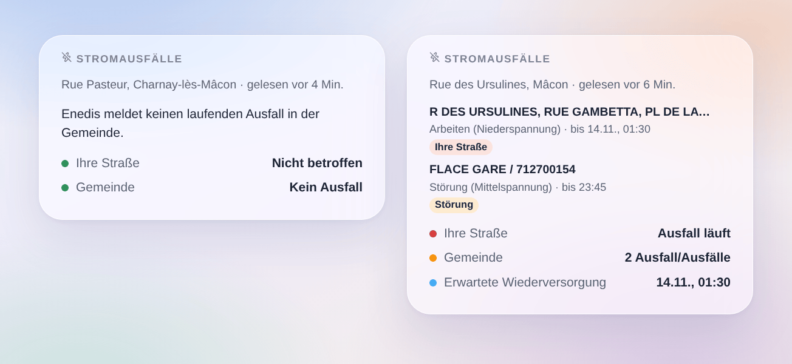

# Enedis-Stromausfälle

## Überblick

Diese Integration bringt die **Stromausfälle**, die Enedis auf seiner Ausfallkarte veröffentlicht (enedis.fr, „Panne et interruption“), für bis zu drei Orte in Gladys: ein Haus von Gladys oder eine eingegebene Adresse.

- ein Gerät pro Ort: ob ein Ausfall in Ihrer Straße oder anderswo in der Gemeinde läuft, wie viele, und die Lage als Satz (bis wann);
- Szenen-Auslöser (Stromausfall, Strom wieder da, Wiederversorgung verschoben, außergewöhnliches Ereignis wie ein Sturm) und eine Szenen-Aktion (die Ausfälle eines Ortes lesen);
- ein Dashboard-Widget „Stromausfälle“.

Enedis veröffentlicht keine offene API für seine Ausfälle: die Integration liest die öffentliche Ausfallkarte von enedis.fr so, wie die Seite es tut, ohne Konto und ohne Schlüssel (Cloud-Transport). Die Adressen werden mit dem Geocoder der Géoplateforme (IGN) gefunden. Eine Community-Integration, kein Dienst von Enedis.

## Voraussetzungen

- Gladys Assistant 5.3.0 oder neuer.
- Ein Ort im französischen Festland, den Enedis versorgt (etwa 95 % der Gemeinden). Gemeinden mit lokalem Versorger (Straßburg, Grenoble, Metz, manche ländliche Gebiete…) sind nicht abgedeckt, ebenso wenig Korsika und die Überseegebiete.
- Entweder ein auf der Karte platziertes Haus von Gladys (Einstellungen → Häuser) oder eine Adresse.

## Konfiguration

1. Integrationen → Coupures Enedis → Konfiguration.
2. Für jeden Ort ein Haus wählen oder eine Adresse eingeben, dann speichern.

| Feld                | Beschreibung                                                                                                       |
| ------------------- | ------------------------------------------------------------------------------------------------------------------ |
| Haus                | Ein Haus von Gladys: die nächste Adresse zu seiner Position ergibt Gemeinde und Straße.                            |
| Oder eine Adresse   | „12 rue des Ursulines 71000 Mâcon“ (Straße überwacht) oder „Mâcon 71000“ (nur Gemeinde). Hat Vorrang vor dem Haus. |
| Enedis gelesen alle | 5, 10, 15 (Standard), 30 oder 60 Minuten. Eine Anfrage pro Ort und Abfrage.                                        |
| Sprache der Texte   | Gerätenamen, Lagen und Szenen-Zusammenfassungen. Automatisch: die Sprache Ihres Dashboards.                        |

**Orte prüfen** zeigt für jeden Ort die gefundene Gemeinde (INSEE-Code) und Straße und liest Enedis sofort. Einmal prüfen: ein grob auf der Karte gesetztes Haus kann in der Nachbarstraße landen.

## Verwendung

### Geräte

Geräte → Coupures Enedis → **Entdecken**, dann Ihren Ort hinzufügen („Enedis Rue des Ursulines, Mâcon“).

| Funktion                 | Gladys-Typ                                                                                   |
| ------------------------ | -------------------------------------------------------------------------------------------- |
| Stromausfall             | Risiko, 0 bis 2: 0 keiner, 1 ein Ausfall in der Gemeinde, 2 ein Ausfall in Ihrer Straße      |
| Ausfälle in der Gemeinde | Zähler: laufende Ausfälle in der Gemeinde (bzw. im Arrondissement in Paris, Lyon, Marseille) |
| Lage                     | Text: „Ausfall in Ihrer Straße (1 in der Gemeinde). Wiederversorgung gegen 01:30 erwartet.“  |

Enedis nennt Straßen oder Umspannstationen, keine Wohnungen: „in Ihrer Straße“ heißt, dass Enedis Ihre Straße unter den betroffenen Orten nennt, wahrscheinlich, aber nicht sicher. Ein Mittelspannungsausfall (HTA) nennt oft nur Stationsnamen: er zählt dann für die Gemeinde.

### Szenen

Auslöser:

- **Enedis: Stromausfall**: ein neuer Ausfall in der Gemeinde. Filter: der Ort, „nur in meiner Straße“ oder „anderswo in der Gemeinde“, und die Art (Störung, Arbeiten, Lastabwurf).
- **Enedis: Strom wieder da**: ein Ausfall ist beendet oder nicht mehr gelistet, mit seiner Dauer.
- **Enedis: Wiederversorgung verschoben**: Enedis verschiebt die erwartete Wiederversorgung oder zieht sie vor.
- **Enedis: außergewöhnliches Ereignis**: Enedis beginnt oder beendet eine Krise (Sturm…), während der evtl. nicht jeder Ausfall gelistet wird.

Aktion:

- **Enedis: Ausfälle lesen**: Ausfall in der Gemeinde, in meiner Straße, Stufe, Anzahl, erwartete Wiederversorgung und ein fertiger Satz.

Beispiele:

- Wenn ein Ausfall in meiner Straße beginnt → eine Nachricht mit `{{triggerEvent.data.summary}}` senden.
- Wenn der Strom wieder da ist → die Wärmepumpe oder Szenen neu starten, die ein Ausfall gestoppt haben könnte.
- Wenn die Wiederversorgung verschoben wird → die neue Uhrzeit senden.
- Vor dem nächtlichen Start der Waschmaschine → die Ausfälle lesen und bei angekündigten Arbeiten verzichten.

### Widget

Dashboard → Bearbeiten → **Stromausfälle** hinzufügen. Den Ort wählen und ob alle Ausfälle der Gemeinde oder nur die Ihrer Straße gezeigt werden. Das Widget zeigt Ihre Straße (grün oder rot), die Zahl der Ausfälle in der Gemeinde und die erwartete Wiederversorgung, dann eine Karte pro Ausfall: betroffene Orte, Art, Netz (Nieder- oder Mittelspannung) und das von Enedis erwartete Ende; die Karte öffnet die Details.

## Fehlerbehebung

- **„Enedis versorgt diese Gemeinde nicht“**: die Gemeinde wird von einem lokalen Verteilnetzbetreiber versorgt, dessen Ausfälle nicht auf der Enedis-Karte stehen.
- **„Adresse nicht gefunden“**: Schreibweise prüfen, Postleitzahl ergänzen oder nur die Gemeinde eingeben.
- **Die falsche Straße**: „Orte prüfen“ nutzen; ist das Haus grob platziert, lieber die Adresse eingeben.
- **„enedis.fr hat die Anfrage abgelehnt“ oder „der Ausfalldienst ist gestört“**: die Integration versucht es bei der nächsten Abfrage erneut; das Intervall bei 15 Minuten oder mehr lassen.
- **„Unerwartete Antwort“**: Enedis hat seine Seite evtl. geändert; ein Issue eröffnen.
- **Ein Ausfall endet ohne Abschluss**: Enedis entfernt einen Ausfall, wenn der Strom wieder da ist; der Auslöser feuert, wenn er verschwindet.
- **Logs**: die Umgebungsvariable `DEBUG=gladys-integration-sdk` hinzufügen, dann ein Issue auf [GitHub](https://github.com/William-De71/gladys-enedis-outages/issues) mit den Versionen von Gladys und der Integration und den Logs eröffnen.
