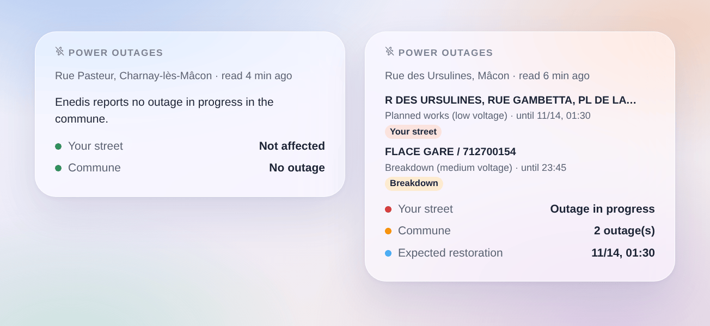

# Enedis outages

## Overview

This integration brings the **power outages** Enedis publishes on its outage map (enedis.fr, "Panne et interruption") into Gladys, for up to three places: a house of Gladys or an address you type.

- a device per place: whether an outage is in progress on your street or elsewhere in the commune, how many, and the situation as a sentence (until when);
- scene triggers (power outage, power back, restoration time moved, exceptional event such as a storm) and a scene action (read the outages of a place);
- a "Power outages" dashboard widget.

Enedis publishes no open API for its outages: the integration reads the public outage map of enedis.fr, the way the page does, with no account and no key (cloud transport). The addresses are found with the geocoder of the Géoplateforme (IGN). This is a community integration, not an Enedis service.

## Requirements

- Gladys Assistant 5.3.0 or later.
- A place in mainland France served by Enedis (about 95 % of communes). Communes served by a local company (Strasbourg, Grenoble, Metz, some rural areas…) are not covered, nor Corsica and the overseas departments.
- Either a house of Gladys placed on the map (Settings → Houses), or an address.

## Configuration

1. Integrations → Coupures Enedis → Configuration.
2. For each place, choose a house or type an address, then save.

| Field                 | Description                                                                                                  |
| --------------------- | ------------------------------------------------------------------------------------------------------------ |
| House                 | A house of Gladys: the nearest address to its position gives the commune and the street.                     |
| Or an address         | "12 rue des Ursulines 71000 Mâcon" (street watched) or "Mâcon 71000" (commune only). It wins over the house. |
| Enedis read every     | 5, 10, 15 (default), 30 or 60 minutes. One request per place and per reading.                                |
| Language of the texts | Device names, situations and scene summaries. Automatic: the language of your dashboard.                     |

**Check the places** shows the commune (INSEE code) and the street found for each place, and reads Enedis at once. Check it once: a house placed roughly on the map may land on the neighbouring street.

## Usage

### Devices

Devices → Coupures Enedis → **Discover**, then add your place ("Enedis Rue des Ursulines, Mâcon").

| Feature                | Gladys type                                                                                   |
| ---------------------- | --------------------------------------------------------------------------------------------- |
| Power outage           | Risk, 0 to 2: 0 none, 1 an outage in the commune, 2 an outage on your street                  |
| Outages in the commune | Counter: outages in progress in the commune (or the arrondissement in Paris, Lyon, Marseille) |
| Situation              | Text: "Outage on your street (1 in the commune). Restoration expected around 01:30."          |

Enedis lists streets or transformer substations, not homes: "on your street" means Enedis names your street among the places cut, likely but not certain. A medium-voltage (HTA) outage often lists only substation names: it then counts for the commune.

### Scenes

Triggers:

- **Enedis: power outage**: a new outage in the commune. Filters: the place, "on my street only" or "elsewhere in the commune", and the kind (breakdown, planned works, load shedding).
- **Enedis: power is back**: an outage is closed or no longer listed, with its duration.
- **Enedis: restoration time moved**: Enedis postpones or brings forward the expected restoration.
- **Enedis: exceptional event**: Enedis starts or ends a crisis (storm…), during which it may not list every outage.

Action:

- **Enedis: read the outages**: outage in the commune, on my street, level, count, expected restoration and a ready-made sentence.

Examples:

- When a power outage starts on my street → send a message with `{{triggerEvent.data.summary}}`.
- When the power is back → restart the heat pump or the scenes a cut may have stopped.
- When the restoration time is postponed → send the new time.
- Before running the washing machine at night → read the outages and skip it when planned works are announced.

### Widget

Dashboard → Edit → add **Power outages**. Choose the place, and whether to show every outage of the commune or only those of your street. The widget shows your street (green or red), the number of outages in the commune and the expected restoration, then one card per outage: places cut, kind, network (low or medium voltage) and the end Enedis expects; the card opens on the details.

## Troubleshooting

- **"Enedis does not serve this commune"**: the commune is served by a local distribution company, whose outages are not on the Enedis map.
- **"Address not found"**: check the spelling, add the postal code, or type only the commune.
- **The wrong street**: use "Check the places"; if the house is roughly placed, type the address instead.
- **"enedis.fr refused the request" or "the outage service is down"**: the integration tries again at the next reading; keep the interval at 15 minutes or more.
- **"Unexpected answer"**: Enedis may have changed its page; open an issue.
- **An outage ends without a closing**: Enedis removes an outage when the power is back; the trigger fires when it disappears.
- **Logs**: add the environment variable `DEBUG=gladys-integration-sdk`, then open an issue on [GitHub](https://github.com/William-De71/gladys-enedis-outages/issues) with the Gladys and integration versions and the logs.
