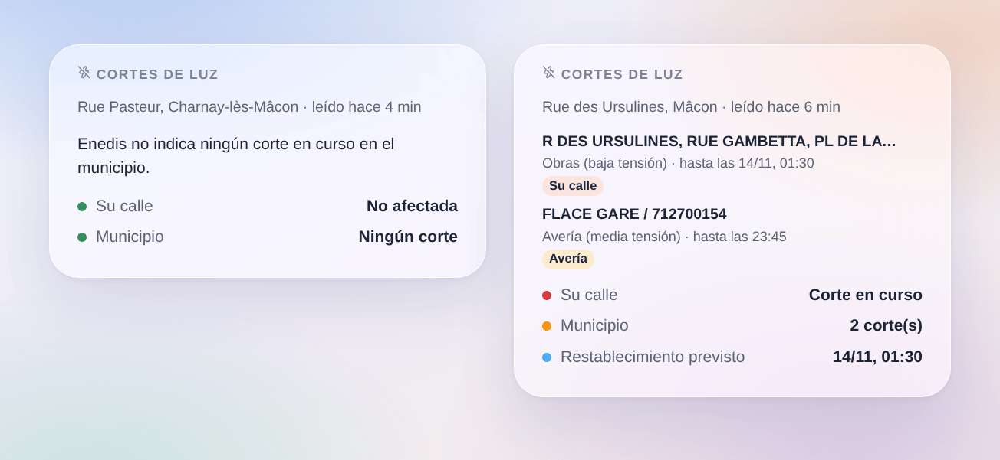

# Cortes de Enedis

## Descripción

Esta integración trae a Gladys los **cortes de luz** que Enedis publica en su mapa de cortes (enedis.fr, «Panne et interruption»), para un máximo de tres lugares: una casa de Gladys o una dirección escrita.

- un dispositivo por lugar: si hay un corte en curso en su calle o en otro lugar del municipio, cuántos, y la situación en una frase (hasta cuándo);
- disparadores de escena (corte de luz, luz restablecida, hora de restablecimiento cambiada, evento excepcional como una tormenta) y una acción de escena (leer los cortes de un lugar);
- un widget de panel «Cortes de luz».

Enedis no publica una API abierta para sus cortes: la integración lee el mapa público de cortes de enedis.fr, como lo hace la página, sin cuenta ni clave (transporte en la nube). Las direcciones se encuentran con el geocodificador de la Géoplateforme (IGN). Es una integración comunitaria, no un servicio de Enedis.

## Requisitos

- Gladys Assistant 5.3.0 o posterior.
- Un lugar de la Francia continental abastecido por Enedis (cerca del 95 % de los municipios). Los municipios abastecidos por una empresa local (Estrasburgo, Grenoble, Metz, algunas zonas rurales…) no están cubiertos, ni Córcega ni los territorios de ultramar.
- Una casa de Gladys situada en el mapa (Ajustes → Casas), o una dirección.

## Configuración

1. Integraciones → Coupures Enedis → Configuración.
2. Para cada lugar, elija una casa o escriba una dirección, y guarde.

| Campo                | Descripción                                                                                                       |
| -------------------- | ----------------------------------------------------------------------------------------------------------------- |
| Casa                 | Una casa de Gladys: la dirección más cercana a su posición da el municipio y la calle.                            |
| O una dirección      | «12 rue des Ursulines 71000 Mâcon» (calle vigilada) o «Mâcon 71000» (solo el municipio). Prevalece sobre la casa. |
| Enedis leído cada    | 5, 10, 15 (por defecto), 30 o 60 minutos. Una petición por lugar y por lectura.                                   |
| Idioma de los textos | Nombres de dispositivos, situaciones y resúmenes de escenas. Automático: el idioma de su panel.                   |

**Comprobar los lugares** muestra el municipio (código INSEE) y la calle encontrados para cada lugar, y lee Enedis al momento. Compruébelo una vez: una casa situada de forma aproximada en el mapa puede caer en la calle vecina.

## Uso

### Dispositivos

Dispositivos → Coupures Enedis → **Descubrir**, y añada su lugar («Enedis Rue des Ursulines, Mâcon»).

| Función                | Tipo de Gladys                                                                             |
| ---------------------- | ------------------------------------------------------------------------------------------ |
| Corte de luz           | Riesgo, 0 a 2: 0 ninguno, 1 un corte en el municipio, 2 un corte en su calle               |
| Cortes en el municipio | Contador: cortes en curso en el municipio (o el distrito en París, Lyon, Marsella)         |
| Situación              | Texto: «Corte en su calle (1 en el municipio). Restablecimiento previsto hacia las 01:30.» |

Enedis cita calles o centros de transformación, no viviendas: «en su calle» significa que Enedis cita su calle entre los lugares cortados, probable pero no seguro. Un corte de media tensión (HTA) a menudo solo cita nombres de centros: entonces cuenta para el municipio.

### Escenas

Disparadores:

- **Enedis: corte de luz**: un nuevo corte en el municipio. Filtros: el lugar, «solo en mi calle» o «en otro lugar del municipio», y el tipo (avería, obras, deslastre).
- **Enedis: luz restablecida**: un corte está cerrado o ya no aparece en la lista, con su duración.
- **Enedis: hora de restablecimiento cambiada**: Enedis aplaza o adelanta el restablecimiento previsto.
- **Enedis: evento excepcional**: Enedis abre o cierra una crisis (tormenta…), durante la cual puede no listar todos los cortes.

Acción:

- **Enedis: leer los cortes**: corte en el municipio, en mi calle, nivel, número, restablecimiento previsto y una frase lista.

Ejemplos:

- Cuando empieza un corte en mi calle → enviar un mensaje con `{{triggerEvent.data.summary}}`.
- Cuando vuelve la luz → reiniciar la bomba de calor o las escenas que un corte haya podido parar.
- Cuando se aplaza el restablecimiento → enviar la nueva hora.
- Antes de poner la lavadora por la noche → leer los cortes y no hacerlo si hay obras anunciadas.

### Widget

Panel → Editar → añada **Cortes de luz**. Elija el lugar, y si mostrar todos los cortes del municipio o solo los de su calle. El widget muestra su calle (verde o rojo), el número de cortes en el municipio y el restablecimiento previsto, y una tarjeta por corte: lugares cortados, tipo, red (baja o media tensión) y el final previsto por Enedis; la tarjeta abre el detalle.

## Solución de problemas

- **«Enedis no abastece este municipio»**: el municipio lo abastece una empresa local de distribución, cuyos cortes no están en el mapa de Enedis.
- **«Dirección no encontrada»**: revise la ortografía, añada el código postal, o escriba solo el municipio.
- **La calle equivocada**: use «Comprobar los lugares»; si la casa está situada de forma aproximada, escriba la dirección.
- **«enedis.fr rechazó la petición» o «el servicio de cortes no funciona»**: la integración lo vuelve a intentar en la siguiente lectura; mantenga un intervalo de 15 minutos o más.
- **«Respuesta inesperada»**: Enedis quizá ha cambiado su página; abra una incidencia.
- **Un corte termina sin cierre**: Enedis retira un corte cuando vuelve la luz; el disparador salta cuando desaparece.
- **Registros**: añada la variable de entorno `DEBUG=gladys-integration-sdk` y abra una incidencia en [GitHub](https://github.com/William-De71/gladys-enedis-outages/issues) con las versiones de Gladys y de la integración y los registros.
