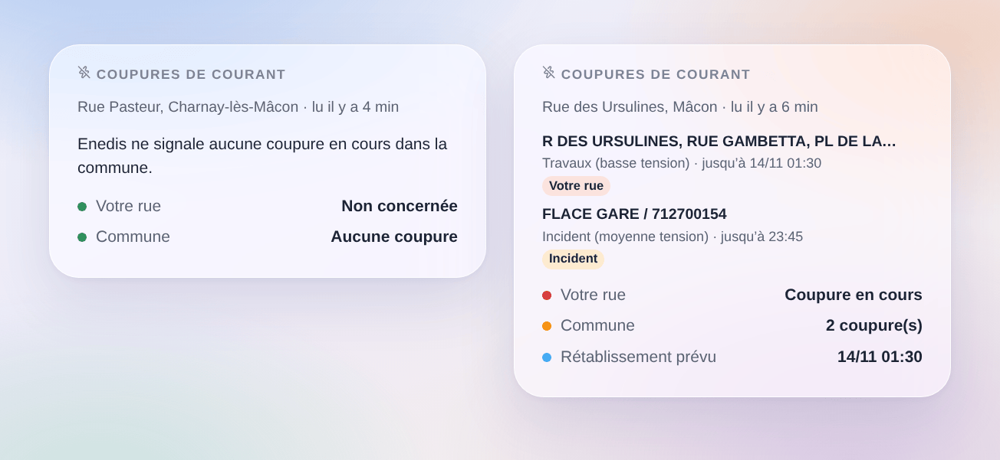

# Coupures Enedis

## Présentation

Cette intégration amène dans Gladys les **coupures de courant** qu’Enedis publie sur sa carte des coupures (enedis.fr, « Panne et interruption »), pour trois lieux au plus : une maison de Gladys ou une adresse saisie.

- un appareil par lieu : une coupure est-elle en cours dans votre rue ou ailleurs dans la commune, combien, et la situation en une phrase (jusqu’à quand) ;
- des déclencheurs de scène (coupure de courant, courant rétabli, heure de rétablissement modifiée, événement exceptionnel comme une tempête) et une action de scène (lire les coupures d’un lieu) ;
- un widget de tableau de bord « Coupures de courant ».

Enedis ne publie pas d’API ouverte pour ses coupures : l’intégration lit la carte publique des coupures d’enedis.fr, comme le fait la page, sans compte ni clé (transport cloud). Les adresses sont trouvées avec le géocodeur de la Géoplateforme (IGN). C’est une intégration communautaire, pas un service d’Enedis.

## Prérequis

- Gladys Assistant 5.3.0 ou plus récent.
- Un lieu de France métropolitaine desservi par Enedis (environ 95 % des communes). Les communes desservies par une régie locale (Strasbourg, Grenoble, Metz, certaines zones rurales…) ne sont pas couvertes, ni la Corse et l’outre-mer.
- Soit une maison de Gladys placée sur la carte (Paramètres → Maisons), soit une adresse.

## Configuration

1. Intégrations → Coupures Enedis → Configuration.
2. Pour chaque lieu, choisissez une maison ou saisissez une adresse, puis enregistrez.

| Champ                | Description                                                                                                             |
| -------------------- | ----------------------------------------------------------------------------------------------------------------------- |
| Maison               | Une maison de Gladys : l’adresse la plus proche de sa position donne la commune et la rue.                              |
| Ou une adresse       | « 12 rue des Ursulines 71000 Mâcon » (rue surveillée) ou « Mâcon 71000 » (commune seulement). Elle prime sur la maison. |
| Enedis lu toutes les | 5, 10, 15 (par défaut), 30 ou 60 minutes. Une requête par lieu et par lecture.                                          |
| Langue des textes    | Noms des appareils, situations et résumés des scènes. Automatique : la langue de votre tableau de bord.                 |

**Vérifier les lieux** affiche la commune (code INSEE) et la rue trouvées pour chaque lieu, et lit Enedis tout de suite. Vérifiez une fois : une maison placée approximativement sur la carte peut tomber sur la rue voisine.

## Utilisation

### Appareils

Appareils → Coupures Enedis → **Découverte**, puis ajoutez votre lieu (« Enedis Rue des Ursulines, Mâcon »).

| Fonctionnalité           | Type Gladys                                                                                 |
| ------------------------ | ------------------------------------------------------------------------------------------- |
| Coupure de courant       | Risque, 0 à 2 : 0 aucune, 1 une coupure dans la commune, 2 une coupure dans votre rue       |
| Coupures dans la commune | Compteur : coupures en cours dans la commune (ou l’arrondissement à Paris, Lyon, Marseille) |
| Situation                | Texte : « Coupure dans votre rue (1 dans la commune). Rétablissement prévu vers 01:30. »    |

Enedis cite des rues ou des postes de transformation, pas des logements : « dans votre rue » veut dire qu’Enedis cite votre rue parmi les lieux coupés, c’est probable mais pas certain. Une coupure moyenne tension (HTA) ne cite souvent que des noms de postes : elle compte alors pour la commune.

### Scènes

Déclencheurs :

- **Enedis : coupure de courant** : une nouvelle coupure dans la commune. Filtres : le lieu, « dans ma rue seulement » ou « ailleurs dans la commune », et le type (incident, travaux, délestage).
- **Enedis : courant rétabli** : une coupure est close ou n’est plus listée, avec sa durée.
- **Enedis : heure de rétablissement modifiée** : Enedis repousse ou avance le rétablissement prévu.
- **Enedis : événement exceptionnel** : Enedis ouvre ou clôt une crise (tempête…), pendant laquelle il peut ne pas lister toutes les coupures.

Action :

- **Enedis : lire les coupures** : coupure dans la commune, dans ma rue, niveau, nombre, rétablissement prévu et une phrase toute faite.

Exemples :

- Quand une coupure commence dans ma rue → envoyer un message avec `{{triggerEvent.data.summary}}`.
- Quand le courant est rétabli → relancer la pompe à chaleur ou les scènes qu’une coupure a pu arrêter.
- Quand l’heure de rétablissement est repoussée → envoyer la nouvelle heure.
- Avant de lancer le lave-linge la nuit → lire les coupures et s’abstenir si des travaux sont annoncés.

### Widget

Tableau de bord → Modifier → ajoutez **Coupures de courant**. Choisissez le lieu, et s’il faut afficher toutes les coupures de la commune ou seulement celles de votre rue. Le widget montre votre rue (vert ou rouge), le nombre de coupures dans la commune et le rétablissement prévu, puis une carte par coupure : lieux coupés, type, réseau (basse ou moyenne tension) et la fin prévue par Enedis ; la carte s’ouvre sur le détail.

## Dépannage

- **« Enedis ne dessert pas cette commune »** : la commune est desservie par une entreprise locale de distribution, dont les coupures ne sont pas sur la carte Enedis.
- **« Adresse introuvable »** : vérifiez l’orthographe, ajoutez le code postal, ou saisissez seulement la commune.
- **La mauvaise rue** : utilisez « Vérifier les lieux » ; si la maison est placée approximativement, saisissez plutôt l’adresse.
- **« enedis.fr a refusé la requête » ou « le service des coupures est indisponible »** : l’intégration réessaie à la lecture suivante ; gardez un intervalle de 15 minutes ou plus.
- **« Réponse inattendue »** : Enedis a peut-être changé sa page ; ouvrez un ticket.
- **Une coupure finit sans clôture** : Enedis retire une coupure quand le courant revient ; le déclencheur part quand elle disparaît.
- **Journaux** : ajoutez la variable d’environnement `DEBUG=gladys-integration-sdk`, puis ouvrez un ticket sur [GitHub](https://github.com/William-De71/gladys-enedis-outages/issues) avec les versions de Gladys et de l’intégration et les journaux.
